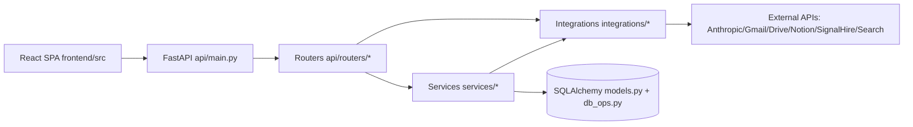

# LH2 Product Demo Architecture Map

This document is a technical walkthrough of the product for senior-dev demo discussions. It covers features, services, integrations, wiring, and decision logic.

## 1) Product Scope at a Glance

LH2 is an API-first publisher CRM and outreach platform with AI-assisted research, sequencing, and execution support.

Primary capabilities:

- Authentication + role/permission checks
- Publisher CRM across independent publishers and media-house brands
- Bulk domain import with deterministic review gating
- Campaign tagging + tracking
- Deep research and intelligence workspace
- Strategist chat and full outreach plan generation
- Action timeline/calendar/history workflows
- Gmail drafting + inbox sync/correlation
- Contact extraction, LinkedIn lookup, and SignalHire enrichment

## 2) Runtime Architecture

Request path:

1. Frontend uses `apiFetch()` and bearer token from `localStorage` (`frontend/src/api/client.ts`)
2. FastAPI routes handle auth/deps and request orchestration (`api/main.py`, `api/deps.py`)
3. Business logic runs in services/integrations (`services/*`, `integrations/*`)
4. Persistence uses SQLAlchemy models + DB ops (`models.py`, `db_ops.py`)

## 3) Entrypoints and App Wiring

Backend:

- App bootstrap: `api/main.py`
- Mounted routers:
  - `auth.py`, `users_routes.py`, `meta.py`
  - `dashboard.py`, `companies.py`, `advisor.py`, `campaigns.py`
  - `sessions.py`, `chat.py`, `plans.py`, `session_actions.py`, `workflows_routes.py`
  - `intelligence_routes.py`, `strategist_contacts.py`
  - `timeline_routes.py`, `calendar_routes.py`, `pipeline_routes.py`, `history_routes.py`, `spoc_routes.py`
  - `gmail_inbox.py`, `google_oauth.py`, `notion_routes.py`
  - `bulk_routes.py`

Frontend:

- Router shell: `frontend/src/App.tsx`
- Global frame/sidebar + source switcher: `frontend/src/shell/AppShell.tsx`
- Main pages:
  - `DashboardPage.tsx`
  - `CompaniesPage.tsx`
  - `IntelligencePage.tsx`
  - `StrategistPage.tsx`
  - `BulkImportPage.tsx`
  - `ActionsPage.tsx`, `TimelinePage.tsx`, `CalendarPage.tsx`, `HistoryPage.tsx`
  - `GmailInboxPage.tsx`

## 4) Data Model (Core Entities)

`models.py` defines key entities:

- User/Auth: `User`
- Pipeline and campaigning: `Campaign`, `Company`, `AdvisorCompany`, `Contact`, `SpocContact`
- Strategist sessions: `Session`, `Message`, `Action`, `MemoryEvent`, `GlobalInsight`, `CachedContext`
- Advisor chat and enrichment: `AdvisorConversation`, `EnrichmentResult`
- Gmail sync: `GmailAccount`, `EmailThread`, `InboxEmail`, `ProcessedGmailMessage`, `GmailOutreachSyncEvent`

## 5) Features -> Services -> Integrations Map

### 5.1 Publisher CRM and Dashboard

Feature:

- List/filter publishers
- KPI slices (total, in campaign, responded, due, etc.)
- Detail drawer for selected publisher/brand
- Retag/reclassify company between independent/media-house

Wiring:

- API: `api/routers/dashboard.py`, `api/routers/companies.py`, `api/routers/advisor.py`
- Service: `services/company_reclassification_service.py`
- Frontend: `frontend/src/pages/DashboardPage.tsx`, `frontend/src/pages/CompaniesPage.tsx`

### 5.2 Bulk Import (Important Demo Piece)

Feature:

- Analyze text/file input
- Domain normalization and dedupe
- DB existence checks
- AI classification (independent vs media_house)
- Optional web ownership verification
- Deterministic policy/judgment layer
- Review gating + override
- Commit + undo + campaign tagging

Wiring:

- API: `api/routers/bulk_routes.py`
- Core service: `services/bulk_domain_import.py`
- Integration calls via `integrations/__init__.py`:
  - `classify_domains_independent_or_media_house`
  - `classify_entries_independent_or_media_house`
  - `verify_parent_from_web`
- UI: `frontend/src/pages/BulkImportPage.tsx`

### 5.3 Campaigns

Feature:

- Create/list campaign entities
- Optionally tag bulk-imported records with campaign IDs

Wiring:

- API: `api/routers/campaigns.py`, linked from bulk commit in `api/routers/bulk_routes.py`
- DB tagging occurs in `services/bulk_domain_import.py` via `imported_campaign_ids` and `last_imported_campaign_id` patches
- UI campaign controls in `frontend/src/pages/BulkImportPage.tsx`

### 5.4 Intelligence / Research

Feature:

- Company/advisor research context
- Deep research status and navigation from CRM drawer
- Save/read research artifacts

Wiring:

- API: `api/routers/intelligence_routes.py`
- AI/research integration: `integrations/ai/research.py`, `integrations/ai/ai_engine.py`
- Drive context/doc helpers: `integrations/drive/sync.py`
- UI: `frontend/src/pages/IntelligencePage.tsx`

### 5.5 Strategist Chat + Outreach Planning

Feature:

- Streaming strategist chat
- Full outreach plan generation (multi-step sequence)
- Commit plan into action timeline
- Export plan as ICS
- Replan on response

Wiring:

- API: `api/routers/chat.py`, `api/routers/plans.py`
- AI planner/replanner: `integrations/ai/ai_engine.py` (`generate_outreach_plan`, `replan_on_response`)
- Schedule fallback: `services/strategist_add_to_action.py` (`scheduled_at_iso_for_strategist_step`)
- UI: `frontend/src/pages/StrategistPage.tsx`

### 5.6 Actions / Timeline / Calendar / History

Feature:

- Log and patch outreach actions
- Shift sequence dates together
- Open action context from dashboard drawer
- Sequence management and status updates

Wiring:

- API: `api/routers/session_actions.py`, `api/routers/timeline_routes.py`, `api/routers/calendar_routes.py`, `api/routers/history_routes.py`
- Date shifting behavior in `api/routers/session_actions.py` (when `shift_following_in_sequence=true`)
- UI pages: `ActionsPage.tsx`, `TimelinePage.tsx`, `CalendarPage.tsx`, `HistoryPage.tsx`

### 5.7 Draft Workflows + Gmail

Feature:

- Refine a draft
- Adapt following sequence drafts after anchor edit
- Convert strategist draft to timeline actions (new/append/overwrite/multi)
- Save Gmail drafts with deck-link HTML injection
- Inbox sync/correlation

Wiring:

- API: `api/routers/workflows_routes.py`, `api/routers/gmail_inbox.py`, `api/routers/google_oauth.py`
- Services: `services/strategist_add_to_action.py`, `services/gmail_sync_service.py`, `services/outreach_correlator.py`, `services/deck_links.py`
- Integrations: `integrations/gmail/service.py`, `integrations/gmail/auth.py`
- UI: `frontend/src/pages/StrategistPage.tsx`, `frontend/src/pages/GmailInboxPage.tsx`

### 5.8 Contacts and Enrichment

Feature:

- Extract contacts from research
- LinkedIn lookup
- SignalHire enrichment
- Ensure/persist selected contact

Wiring:

- API: `api/routers/strategist_contacts.py`
- Service: `services/signalhire_enrichment.py`
- Integrations: `integrations/search/linkedin_lookup.py`, `integrations/signalhire/enrichment.py`
- UI: `frontend/src/pages/StrategistPage.tsx`

## 6) Deep Logic Walkthroughs

### 6.1 How Bulk Import Categorization Works

Primary implementation: `services/bulk_domain_import.py`

Pipeline:

1. Parse inputs:
   - File parser (`_parse_domains_from_file`) supports CSV/XLSX
   - Text parser (`_parse_entries_from_text`) supports line/comma inputs
2. Normalize and dedupe domains (`normalize_domain`)
3. Fetch known parent media houses (`get_existing_parent_media_houses`)
4. Run AI classification:
   - domain mode: `classify_domains_independent_or_media_house`
   - entry mode: `classify_entries_independent_or_media_house`
5. For potential media-house entries, optionally verify ownership from web (`verify_parent_from_web`)
6. Run deterministic policy resolver `resolve_import_judgment(...)`:
   - DB existence overrides model output
   - parent-company candidates can be accepted as new parents
   - web-verified parent matches are high-trust
   - parent suggestion fallback uses deterministic matching (`_suggest_parent_from_data`)
   - ambiguous/low-confidence cases are marked review-required
7. Return review rows with:
   - classification, parent fields, reasons, confidence, evidence
8. Commit stage (`commit_rows`) enforces gating:
   - `stage_b`: gates media-house rows requiring review
   - `stage_c`: gates all review-required rows
   - optional override per-row via `override_review_block`
9. Persist metadata and audit events in `extra_data`:
   - source, decision reason/confidence, override usage, campaign IDs
10. Launch async syndication refresh post-commit for new records
11. Support undo by deleting created rows (`undo_created`)

### 6.2 How Reachout Dates Are Decided

There are multiple scheduling paths:

1. AI plan generation path:
   - `generate_outreach_plan()` in `integrations/ai/ai_engine.py`
   - LLM outputs `STEP|...|Day X|...`
   - parser `_parse_sequence_response()` extracts day offset and sets:
     - `scheduled_at = datetime.utcnow() + timedelta(days=day_offset)`

2. Plan commit fallback path:
   - `api/routers/plans.py` (`/sessions/{id}/outreach-plan/commit`)
   - if a step has no `scheduled_at`, fallback is:
     - `scheduled_at_iso_for_strategist_step(idx)`
     - from `services/strategist_add_to_action.py`
     - base = today UTC noon
     - gap = `STRATEGIST_SEQUENCE_DAY_GAP = 3` days per step

3. Manual next-step edit path from dashboard drawer:
   - `patchDrawerNextStepDate()` in `frontend/src/pages/DashboardPage.tsx`
   - chooses next candidate planned action from `planned_preview`
   - PATCH `/api/actions/{action_id}` with `shift_following_in_sequence: true`
   - backend in `api/routers/session_actions.py` shifts later sequence steps by same delta

4. Append step heuristic path:
   - `add_step_to_existing_sequence()` in `services/strategist_add_to_action.py`
   - infers schedule using neighboring email-numbered steps:
     - midpoint between surrounding emails
     - or +/- 2 days around nearest known step

### 6.3 How the Dashboard Drawer Is Formed

Main drawer is in `frontend/src/pages/DashboardPage.tsx`.

Construction:

- Drawer opens when:
  - independent mode: `selectedGroup` is set
  - media mode: `selectedMediaBrand` is set
- Right panel rendered as `<aside className="panel crm-right drawer-panel">`
- Positioning uses CSS variable `--drawer-y` from local state `drawerYOffsetPx`
- Tabs inside drawer:
  - `overview`
  - `campaign` ("Campaign & Outreach")
- Drawer includes:
  - research status check (`/api/intelligence/has-research`)
  - status + relevance + traffic + syndication
  - next-step date editor
  - SPOC/contact summaries
  - reclassification trigger
- Close behavior resets selection, drawer state, and research check flags

Related UI overlays (not the main CRM drawer but same pattern):

- Strategist add-to-timeline popup in `frontend/src/pages/StrategistPage.tsx` (`strategist-add-overlay`)
- Rules popup in `frontend/src/pages/StrategistPage.tsx`
- Add Publisher and Retag modals in `DashboardPage.tsx` (`crm-add-publisher-overlay`)

## 7) Integrations Matrix

Primary integration entrypoint: `integrations/__init__.py`.

External systems and typical usage:

- Anthropic/AI:
  - Chat, planning, replan, research, classification
  - `integrations/ai/ai_engine.py`, `integrations/ai/research.py`
- Search:
  - ownership verification, LinkedIn lookup
  - `integrations/search/ownership_verifier.py`, `integrations/search/linkedin_lookup.py`
- SignalHire:
  - contact enrichment
  - `integrations/signalhire/enrichment.py`, `services/signalhire_enrichment.py`
- Gmail:
  - draft creation, OAuth, inbox sync/correlation
  - `integrations/gmail/*`, `services/gmail_sync_service.py`
- Google Drive:
  - context/doc operations
  - `integrations/drive/sync.py`
- Notion:
  - sync and note/page operations
  - `integrations/notion/sync.py`, `integrations/notion/sync_advisor.py`
- Analytics/tracker:
  - syndication and platform analytics data
  - `integrations/analytics/*`

## 8) Service Layer Inventory

`services/` currently includes:

- `bulk_domain_import.py`
- `company_reclassification_service.py`
- `gmail_sync_service.py`
- `outreach_correlator.py`
- `strategist_add_to_action.py`
- `outreach_state.py`
- `outreach_classifier.py`
- `gmail_service.py`
- `drive_context_merge.py`
- `ui_data_loader.py`
- `signalhire_enrichment.py`
- `media_house_platform_analytics.py`
- `deck_links.py`
- `cache_registry.py`

## 9) Frontend Page-to-Backend Wiring (Quick Map)

- `DashboardPage.tsx` -> `/api/dashboard/*`, `/api/actions/{id}`, `/api/intelligence/has-research`, `/api/companies/reclassify`
- `CompaniesPage.tsx` -> company/advisor APIs and workspace selection
- `IntelligencePage.tsx` -> `/api/intelligence/*`
- `StrategistPage.tsx` -> `/api/sessions/*`, `/api/strategist/*`, `/api/actions/*`, `/api/gmail/draft`
- `BulkImportPage.tsx` -> `/api/bulk/analyze-file`, `/api/bulk/analyze-text`, `/api/bulk/commit`, `/api/bulk/undo`, `/api/campaigns`
- `ActionsPage.tsx` -> session action APIs
- `TimelinePage.tsx` and `CalendarPage.tsx` -> timeline/calendar APIs
- `GmailInboxPage.tsx` -> Gmail inbox and sync APIs

## 10) Demo Script (Senior-Dev Friendly)

1. Start on `Dashboard`:
   - show source toggle (independent/media), KPI filtering, drawer behavior
2. Open drawer:
   - show research detection, next-step date edit, and sequence shift behavior
3. Go to `Bulk import`:
   - show analyze -> deterministic review fields -> commit gating -> campaign tagging
4. Open `Intelligence`:
   - show research context and artifact flow
5. Open `Strategist`:
   - stream chat, generate full plan, add/append/overwrite timeline steps
   - mention persist-following-drafts behavior
6. Open `Actions`/`Timeline`:
   - show sequence structure and scheduled dates
7. Open `Gmail inbox`:
   - show sync/correlation and draft lifecycle touchpoints

## 11) Important Technical Notes to Mention

- API-first runtime with React frontend (`api/main.py`, `frontend/src/App.tsx`)
- Role/permission checks happen in deps + router layer
- Bulk import is not pure AI: deterministic policy layer controls commit safety
- Sequence scheduling is hybrid:
  - AI day offsets + parser
  - deterministic fallback spacing
  - user edits can shift entire sequence
- Drawer is state-driven from selected row/brand, not separate route
- Integrations are modularized under `integrations/*` with service-level orchestration

## 12) Files You Should Keep Open During Demo Q&A

- `api/main.py`
- `services/bulk_domain_import.py`
- `api/routers/plans.py`
- `api/routers/session_actions.py`
- `api/routers/workflows_routes.py`
- `services/strategist_add_to_action.py`
- `integrations/ai/ai_engine.py`
- `frontend/src/pages/DashboardPage.tsx`
- `frontend/src/pages/BulkImportPage.tsx`
- `frontend/src/pages/StrategistPage.tsx`
- `models.py`

